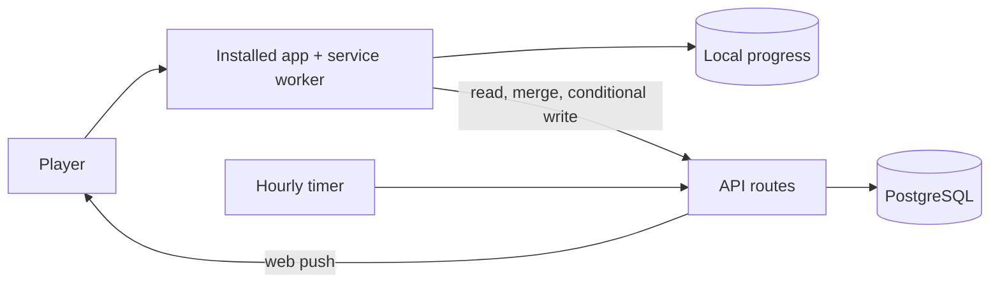

# World Flags

> A game for learning every country, flag and capital in the world: short daily practice that brings back what you are about to forget, and a timed mode with a public ranking.

*Juego para aprender los países, las banderas y las capitales del mundo con repetición espaciada.*
*Se instala en el teléfono, funciona sin conexión y guarda el progreso en la nube.*

[Play it](https://world-flags-hazel.vercel.app) · In production · v2.12.1 · [](https://github.com/Fockus26/World-Flags/actions/workflows/ci.yml) [](./LICENSE)

<!-- Screenshot pending: docs/readme/flags-session.png (a Flags practice card mid-session, phone 390×844, demo data). -->

> The app's interface is in Spanish. Code, issues and PRs can be in English or Spanish.

## What it does

- A player picks one of three games (which countries belong to each continent, which country a flag belongs to, which capital a country has) and plays the whole world, any mix of continents, or hand-picked countries.
- In practice mode the app decides what to ask: countries the player keeps missing come back sooner, the ones they know are spaced out, and a daily queue gathers everything due today.
- In competitive mode the session is a stopwatch, wrong answers and skips cost time, and the best time goes to a public ranking, per game, for the whole world and per continent.
- A player with an account continues on another device where they left off; without one they play as a guest and nothing leaves the phone.
- The app installs like a native one and keeps working without a connection, including the 197 flags.
- Streaks with an activity calendar, achievements and an optional daily reminder give the player a reason to come back tomorrow.

## How it is built

| Layer | Choice |
|---|---|
| Framework | [Astro 7](https://astro.build): a prerendered page that mounts one React island, plus API routes as serverless functions |
| UI | React 19 with the React Compiler, strict TypeScript, [HeroUI v3](https://www.heroui.com/) on Tailwind CSS v4 driven by design tokens; light, dark or system theme |
| State | Redux Toolkit, reached only through hooks in `src/hooks/`; local persistence through a single storage module |
| Learning | SM-2 spaced repetition, a practice queue and learning in batches, all pure functions in `src/utils/` |
| Data | PostgreSQL with [Drizzle](https://orm.drizzle.team): one private progress row per player, a public ranking table validated by a trigger |
| Auth | [Better Auth](https://better-auth.com): email with confirmation, or Google; httpOnly cookie |
| Offline | Hand-written service worker (`public/sw.js`) and web manifest; self-hosted flags and font |
| Reminders | Web Push, sent by a scheduled call to a protected route |
| Hosting | Vercel for the app and its functions; self-hosted Postgres behind a connection pooler |



## Decisions worth noting

**Progress syncs by merging, and an upload only lands if nobody wrote in between.**
The first version uploaded the whole progress row after every answer: with two devices open, the last one to upload erased the other, and a session played offline was lost at the next sync. Now every upload reads the row, merges it with local data (per country, the most recent review wins) and writes with `UPDATE … WHERE updated_at = <the version read>`; zero rows written means another device got there first, so it reads and merges again, up to three rounds. Uploads are grouped (5 s idle, 60 s cap), which took a long practice from about 60 writes to about 5. The cost: each upload still carries the whole row, and a client still running an old cached version uploads unconditionally until it updates. Evidence: `src/server/data/learning-data.ts`, `tests/unit/sync-merge.test.ts`, `tests/unit/sync-concurrency.test.ts`.

**The ranking is validated in the database, not in the client.**
The ranking is public and anyone with a session can call the route, so the client cannot be trusted. A trigger on the ranking table rejects times under a per-scope minimum (number of countries × 300 ms, more than twice the typing world record), unknown scopes, blank or invisible names and invalid avatars; it sets the date itself and keeps the better of the old and new time, so a worse run never replaces a better one. A trigger was chosen over reading before writing because it is atomic and also covers old clients. A test compares the minimums in the SQL with the ones the client uses. The cost: it does not prove the game was played; any time above the minimum is accepted. Replaying each game on the server was considered and left out. Evidence: `drizzle/0001_ranking_validacion.sql`, `tests/unit/leaderboard-validation.test.ts`.

**Leaving Supabase for a self-hosted Postgres.**
Database and auth moved to a Postgres server with Drizzle and Better Auth, so the product does not depend on a paid plan. Each row-level security policy became an explicit check in its API route, with the user id taken from the session and never from the request body, and one test per policy. Existing accounts kept their ids and passwords: the old bcrypt hashes are still verified. Daily reminders are triggered by a system timer calling a protected route instead of a platform cron. The cost: earlier service workers had cached API responses, so the first new one had to take over and reload open tabs once; and after the cut there was no way back. Evidence: `src/server/`, `src/pages/api/`, `tests/api/authorization.test.ts`.

**The flags are part of the app, not a CDN call.**
Practising offline a continent that had never been opened showed broken images. The 197 flags are served from the app's own origin, and a few seconds after load the app sends the list to the service worker, which downloads only the missing ones and resumes where it stopped if the network drops. It never runs with data saver on or on a 2G connection. The cost: about 3.1 MB once per device, and again if the cache name ever changes. Evidence: `public/sw.js`, `tests/unit/flag-precache.test.ts`.

## Quality

- **Tests:** about 440 unit tests in 37 files (progress merge and concurrent sync, practice queue and learning path, ranking validation, capitals answers, service worker precache, session handling), 34 access-policy tests against the API with a local database, and 14 end-to-end tests with Playwright.
- **CI:** every pull request runs typecheck, lint (Biome), the unit suite and a production build.
- **Releases:** each player-visible change ships with a changeset; the changelog it produces is what the in-app "what's new" dialog shows, and a server-side minimum version can require outdated installs to update.
- **Accessibility:** built to WCAG 2.1 AA: full keyboard support, visible focus, no state conveyed by colour or sound alone, usable down to 320 px.
- **Decision records:** every non-trivial decision has a numbered record in [`context/decisions/`](./context/decisions/), with the alternatives that were discarded.

## Run it locally

**Requirements:** [Bun](https://bun.sh) 1.3+ and Node.js 22.12+.

```sh
git clone https://github.com/Fockus26/World-Flags.git
cd World-Flags
bun install
cp .env.example .env   # then fill in what you need
bun run dev            # http://localhost:4321
```

Without a database the app works as a guest. Accounts and sync need a PostgreSQL database; the schema is in [`drizzle/`](./drizzle) (see [`drizzle/README.md`](./drizzle/README.md)).

Environment variables, by name (see `.env.example` for what each one does):

- Database: `DATABASE_URL`, `DIRECT_URL`
- Auth: `BETTER_AUTH_SECRET`, `BETTER_AUTH_URL`, `GOOGLE_CLIENT_ID`, `GOOGLE_SECRET`
- Email: `SMTP_HOST`, `SMTP_PORT`, `SMTP_USER`, `SMTP_PASS`, `SMTP_FROM`
- Reminders: `PUBLIC_VAPID_PUBLIC_KEY`, `VAPID_PRIVATE_KEY`, `VAPID_SUBJECT`, `CRON_SECRET`

| Command | What it does |
|---|---|
| `bun run dev` | Start the dev server |
| `bun run build` | Production build to `./dist/` |
| `bun run preview` | Preview the production build |
| `bunx astro check` | Type-check |
| `bunx biome check ./src` | Lint and format check |
| `bun run test` | Unit tests (`tests/unit`) |
| `bun run test:api` | Access-policy tests (`tests/api`, needs the local QA stack running) |
| `bun run test:e2e` | Playwright end-to-end tests (needs the dev server running) |
| `bun run db:migrate` | Apply the migrations in `drizzle/` to `DIRECT_URL` |

> **Service worker tip:** the SW caches aggressively. If you don't see your changes in dev,
> unregister it and clear caches from DevTools (Application → Service workers / Storage).

## Project structure

```text
src/
  components/
    app/        Providers and startup effects (auth, sync, theme, achievements), snackbars
    game/       Home screen and its dialogs, sessions for the three games, results
    ui/         Wrappers over HeroUI (Button, Modal, Select, Tooltip…)
  data/         Countries and capitals datasets
  hooks/        The only way components touch Redux (useGame, useAuth, useAchievements…)
  pages/        The app shell and the API routes (auth, progress, ranking, push, cron)
  server/       Database schema and client, auth setup, email, data access
  store/        Redux Toolkit store and slices
  styles/       Tailwind entry, design tokens, HeroUI theme bridge
  utils/        SM-2, practice queue, scope resolution, storage, cloud sync, achievements
public/         Flags, PWA icons, manifest, service worker
drizzle/        SQL migrations and seed
tests/          Unit tests and API access-policy tests
e2e/            Playwright tests
docs/           State management, design system, components, PWA assets
context/        Design rules, tokens and decision records
```

Deeper dives: [state management](./docs/state-management.md), [design system](./docs/design-system.md), [components](./docs/components.md).

## My role

A personal product. I defined it and developed all of it: the three games and their learning logic, accounts and progress sync, the public ranking and its validation, the offline app, the database and its migration off Supabase, and the release pipeline.

## Contributing and license

Contributions are welcome: [`CONTRIBUTING.md`](./CONTRIBUTING.md) describes the workflow (branches, Conventional Commits, pull requests). What is planned next is in [`TODO.md`](./TODO.md). Released under the [MIT](./LICENSE) license.
